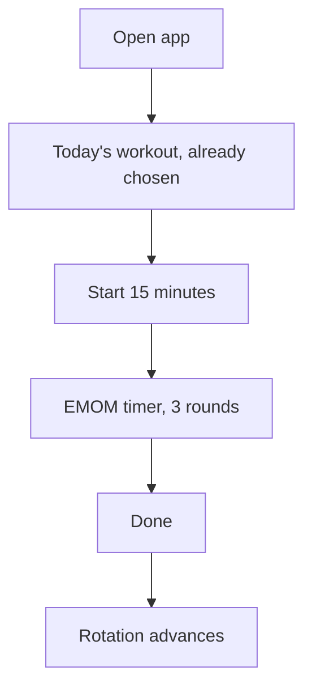

# Morning 3 + 15: Specification (Revised)

Revision 2. Supersedes `morning-3-plus-15-web-app-spec.md`.
See Appendix A for what changed and why.

---

## Product summary

**Morning 3 + 15** supports a daily routine of a three-mile run followed by a
15-minute kettlebell workout. The run is tracked on a Garmin Forerunner. **This
app covers the fifteen minutes only.**

Its job is to answer one question every morning without being asked twice:
*what am I doing today, and for how long?*

Operating principle: **open, lift, finish.**

The normal daily experience requires no planning, no workout selection, and no
data entry.

---

## 1. Scope

In scope:

- Today's kettlebell workout, chosen automatically.
- A 15-minute EMOM timer.
- Lightweight logging of reps and weight.
- Workout history.
- Offline operation as an installed iPhone home-screen app.

Out of scope, permanently:

- Run tracking of any kind. The Garmin owns that.
- Accounts, sync, social features, leaderboards, nutrition, calorie estimates.
- Live GPS, wearable integration, AI-generated workouts, billing.

Out of scope for Phase 1, planned for Phase 2:

- Progression engine (Section 10).
- Dashboard metrics beyond the current streak (Section 11).
- Pain flagging and automatic substitution prompts (Section 9.3).
- Voice countdown.

---

## 2. Primary flow



There is one primary action on the home screen and one thing to finish. Logging
is optional and never blocks the flow.

---

## 3. Home screen

Display:

- Current date.
- Current streak.
- Today's workout: A, B, C, or Recovery, with its emphasis.
- One primary action: `Start 15 Minutes`.
- Last session summary.

```text
Good morning, Michael

TUESDAY, 25 AUGUST              11-day streak

TODAY: WORKOUT B
Squat + push

        [ START 15 MINUTES ]

Last session
Workout A · 3 rounds · yesterday
Swing 18 · Row 10 · Carry 40s
```

Secondary affordances, deliberately small: change today's workout, open history.

---

## 4. Scheduling

### 4.1 Rotation

Strength workouts cycle `A -> B -> C -> A`. The next workout is determined by
the **last completed strength session**, never by the calendar.

```typescript
function nextStrengthWorkout(lastCompletedStrength: "A" | "B" | "C" | null) {
  if (lastCompletedStrength === "A") return "B";
  if (lastCompletedStrength === "B") return "C";
  return "A"; // covers "C" and the first-ever session
}
```

`lastCompletedStrength` is **derived from session history on read**, never
stored, so it cannot drift out of sync with the log.

### 4.2 Recovery is transparent

Recovery sessions do not occupy a position in the rotation. Completing one never
changes what strength workout comes next.

```text
Fri  B completed
Sat  nothing
Sun  Recovery completed
Mon  -> C     (not A)
```

### 4.3 Calendar interaction

- The configured recovery weekday (default Sunday) suggests Recovery.
- Skipping a day does not advance the rotation.
- The user may override today's workout at any time.
- Overrides are recorded on the session as `manualOverride: true`.

### 4.4 Skipping

There is an explicit "not today" action. It writes a session with
`status: "skipped"`, which keeps missed days distinguishable from days the app
was never opened. Skipped days do not advance the rotation and do not count
toward the streak.

---

## 5. Streak

A streak is the count of consecutive days, ending yesterday, where each day
either has a completed session or falls on the configured recovery weekday.

Three consequences, all intentional:

- The scheduled rest day never breaks the streak, whether or not anything is
  logged. An app that punishes you for taking the rest day it prescribed is an
  app you come to resent.
- Today not being done yet does not break the streak, so the number on the home
  screen is stable when you open it before training.
- A deliberate skip breaks it. That is the point of skipping deliberately.

---

## 6. Returning after time away

This section did not exist in the original spec and is the most important
addition. A daily training habit will break: travel, illness, weather, a tweaked
back. What the app does on the day you come back determines whether you come
back at all.

### 6.1 Trigger

On load, if the last completed session was **14 or more days ago**
(`LAPSE_DAYS`, a tunable constant), show a return screen once. Dismissal is
recorded against that specific session timestamp so it never nags twice for the
same lapse.

### 6.2 Behavior

```text
Welcome back

It's been 19 days since Workout B.
Picking up at Workout C.

[ Ease back in ]        [ Resume at my old numbers ]
```

`Ease back in` de-loads: every exercise target drops to the bottom of its
prescribed range, and progression is suppressed until two sessions have been
completed. `Resume` keeps the targets as they were.

Showing someone the reps they hit at peak on their first morning back after
three weeks off is how the habit dies. De-loading is the default for a reason.

---

## 7. Workouts

All training days are 15-minute EMOM: five one-minute intervals per round,
three rounds. Each minute is **40 seconds of work and 20 seconds of rest**.
Work for the full 40 seconds; the rep targets are what a solid 40 seconds
looks like, not a set to finish early. One-sided movements switch at a beep
halfway through the work. The 20-second rest is for logging the movement just
done and setting up the next one, which the screen shows.

Every kettlebell day mixes hinge, squat or lunge, push and pull, so a missed
day never leaves a whole movement pattern out. Planks and core holds are left
out on purpose: a separate plank app covers them. Across
one A/B/C cycle (which includes three Bodyweight days) pulling outnumbers
pushing, which is deliberate.

### Workout A: Hinge and pull

| Slot | Exercise | Target |
|---|---|---:|
| 1 | Two-handed kettlebell swing | 15-20 reps |
| 2 | Double-kettlebell bent-over row | 8-10 reps |
| 3 | Double push press | 6-8 reps |
| 4 | Single-leg Romanian deadlift | 5-6 reps per side |
| 5 | Double farmer hold | 40 sec |

The press sits between the grip-heavy movements so grip is not the limiter.

### Workout B: Squat and push

| Slot | Exercise | Target |
|---|---|---:|
| 1 | Double-kettlebell front squat | 8-10 reps |
| 2 | Gorilla row | 10-12 reps, alternating |
| 3 | Double-kettlebell floor press | 8-12 reps |
| 4 | Goblet lateral lunge | 8-10 reps, alternating |
| 5 | Double kettlebell deadlift | 10-12 reps |

The row and the deadlift are kept apart so the low back gets a break.

Substitution: double front squat becomes single-bell goblet squat.

### Workout C: Unilateral and shoulder stability

| Slot | Exercise | Target |
|---|---|---:|
| 1 | Goblet reverse lunge | 5-6 reps per side |
| 2 | One-arm clean and press | 4-6 reps per side |
| 3 | Single-arm row | 6-8 reps per side |
| 4 | One-arm snatch | 5-7 reps per side |
| 5 | Single-arm floor press | 6-8 reps per side |

Substitution: standing clean and press becomes half-kneeling one-arm press.

### Bodyweight: Pull and push

| Slot | Exercise | Target |
|---|---|---:|
| 1 | Pull-up | 5-7 reps |
| 2 | Dip | 5-8 reps |
| 3 | Chin-up | 5-7 reps |
| 4 | Bulgarian split squat | 6-8 reps per side |
| 5 | Hanging leg raise | 6-10 reps |

Bodyweight comes round three times per A/B/C cycle, so it carries two pulls to
one push. The split squat is low impact on purpose: the daily run
already pounds the legs. The three hanging movements alternate with the dip and jump squat so
grip recovers between them. Push-ups stay in the exercise library for
history but are out of the rotation; the floor press covers that pattern.

### Recovery

Three rounds of five one-minute movements: halo, glute bridge, dead bug,
hip-flexor mobility, light suitcase carry.
Recovery is not split into work and rest: each movement runs the full minute.

Recovery never triggers progression and never advances the rotation.

---

## 8. Scaling, without a questionnaire

The original spec gated the timer behind a "how recovered do you feel?" prompt
whose answer the app then translated into a change. This inverts that: the
controls that change the session are on the session itself, available before and
during the workout.

- **4 rounds instead of 5.** One tap, any time, including mid-workout.
- **Swap to Recovery.** One tap, any time.
- **Use a substitution.** Per exercise, recorded on the result.

No mood question, no gate. You tap the thing you actually want to change.

Workload is never automatically increased following a session that was scaled,
cut short, or preceded by a lapse.

---

## 9. Logging

### 9.1 Principle

Logging is inline, optional, and always editable. It is never a form and never
blocks anything.

Every exercise carries two editable values: **reps** (or seconds, for holds) and
**weight**. Both are prefilled from your last session of that workout, so if you
did what you did last time, you touch nothing and the log is already right. You
only interact when you deviate.

### 9.2 Where and when

The same editable row appears in three places:

- **Before**, on the workout preview, to pre-set numbers.
- **During**, on the timer screen, sized for one thumb during the rest window.
- **After**, from history. Sessions remain editable indefinitely.

```text
WORKOUT A                      ROUND 3/5

              00:37

TWO-HANDED SWING
15-20 reps

        [ − ]    18    [ + ]         45 lb

Next: Double-bell row · 8-10

           [ PAUSE ]
```

### 9.3 Granularity

Results are recorded **per exercise**, not per round. Three numbers per session,
not fifteen. Per-round logging is a data shape nobody sustains past week two.

Not captured, by explicit decision: difficulty score, technique rating, session
notes as a prompt, and pain areas. Pain flagging moves to Phase 2 as a long-press
on an exercise rather than a post-workout form.

---

## 10. Progression (Phase 2)

Weight is variable and logged per exercise, so progression has two axes rather
than the original spec's one. Progression reads what was logged. There is no
difficulty or technique input to key off.

Rule, per exercise:

```typescript
if (
  lastTwoSessions.every(s => s.roundsCompleted >= s.roundsPlanned) &&
  lastTwoSessions.every(s => s.actual >= s.target) &&
  !inPostLapseDeload
) {
  // repetitions: +1, capped at targetMax
  // holds: +5 seconds, capped at 45
}
```

Order of progression:

1. Reach the top of the prescribed repetition range.
2. Extend holds toward 45 seconds.
3. Increase weight, if heavier bells are available.
4. Only then offer an advanced movement variation.

The app never encourages exceeding a configured maximum to create exhaustion.

---

## 11. History

Phase 1: a reverse-chronological list of sessions. Tap any one to open the same
editable rows used during the workout.

```text
Tue 25 Aug   Workout B · 3 rounds
Mon 24 Aug   Workout A · 3 rounds
Sun 23 Aug   Recovery
Sat 22 Aug   skipped
```

Phase 2 adds: sessions completed, rounds completed, A/B/C frequency, per-exercise
progression over time, longest streak, substitution history.

The dashboard emphasizes consistency and capability. No calorie theater.

---

## 12. Data

### 12.1 Storage

`localStorage`, single versioned key. A session record is a few hundred bytes,
so a year of training is roughly 200KB against a 5MB budget. IndexedDB buys
async complexity and nothing else at this scale. Persistence sits behind a small
module so it can be swapped later without touching anything else.

**Durability caveat.** Browser storage is the only copy. It does not survive a
phone reset, clearing site data, or removing the home-screen app. A
`Copy my data` button at the bottom of history puts the full JSON on the
clipboard. There is no file export: an installed iOS PWA cannot reliably trigger
a download.

### 12.2 Model

```typescript
type WorkoutType = "A" | "B" | "C" | "RECOVERY";

type Session = {
  id: string;
  date: string;                  // local calendar date, YYYY-MM-DD
  startedAt?: string;
  completedAt?: string;
  workoutType: WorkoutType;
  status: "active" | "completed" | "skipped";
  roundsPlanned: number;         // 5, or 4 when scaled
  roundsCompleted: number;
  manualOverride: boolean;
  postLapseDeload: boolean;
  notes?: string;
  results: ExerciseResult[];
};

type ExerciseResult = {
  exerciseId: string;
  targetType: "repetitions" | "seconds";
  target: number;                // as prescribed at session time
  actual?: number;
  weightLb?: number;
  substitutionUsed?: string;
};

type MuscleGroup =
  | "quadriceps" | "hamstrings" | "glutes" | "chest" | "back"
  | "shoulders" | "arms" | "core" | "grip" | "mobility";

type Exercise = {
  id: string;
  name: string;
  equipment: "one-kettlebell" | "two-kettlebells" | "bodyweight";
  primaryMuscles: MuscleGroup[];
  secondaryMuscles: MuscleGroup[];
  targetType: "repetitions" | "seconds";
  targetMin: number;
  targetMax?: number;
  perSide: boolean;
  formCues: string[];
  substitutionExerciseId?: string;
};

type Settings = {
  kettlebellCount: number;         // 2
  defaultWeightLb: number;         // 45, used to prefill
  strengthDurationMinutes: number; // 15
  recoveryWeekday: number;         // 0 = Sunday
  soundEnabled: boolean;
  weightUnit: "pounds" | "kilograms";
};
```

Today's workout is **derived** from history plus the calendar. Scheduled sessions
are not pre-created; a session row exists only once you start or skip one.

---

## 13. EMOM timer

The central feature.

### 13.1 Behavior

- 15 minutes, 3 rounds, five one-minute intervals per round.
- Training days split each minute into 40 seconds of work and 20 of rest;
  Recovery runs each minute unsplit.
- Three-second countdown before the first interval.
- Audio: a high beep at the start of work, a lower beep at the start of rest,
  a double beep halfway through work for one-sided movements, and a chime on
  completion.
- A tick every second over the final three seconds of work and of rest (five
  seconds of each minute on Recovery).
- During rest the next exercise takes the headline, while the logging row for
  the one just finished stays on screen.
- Pause, resume, previous interval, next interval.
- Screen kept awake for the duration.
- Active state survives a refresh or a browser suspension.

### 13.2 Implementation

Remaining time is **derived from timestamps**, never decremented:

```text
elapsed   = now - startedAt - pausedTotal
interval  = floor(elapsed / 60000)          // 0..14
remaining = 60000 - (elapsed % 60000)
round     = floor(interval / 5) + 1
segment   = (elapsed % 60000) < 40000 ? work : rest
```

Nothing accumulates drift, and a mid-workout refresh restores the exact position.
The active session is written to storage on each tick.

### 13.3 iOS constraints, stated plainly

These are facts about Safari on iPhone, not preferences:

- **There is no haptic feedback.** iOS Safari does not implement the Vibration
  API. The original spec's haptic signals and vibration toggle cannot work and
  have been removed rather than shipped as a dead switch.
- **The workout does not run with the screen locked.** When an iOS PWA is
  backgrounded or the screen locks, timers throttle and the audio context
  suspends. Minute cues will not fire.
- **What does work:** the Wake Lock API (Safari 16.4+) holds the screen on for
  the full fifteen minutes. The phone stays unlocked and awake on the mat. That
  is the deal.
- **Audio needs a gesture.** The AudioContext is created and resumed inside the
  Start button's click handler. Created any later, it starts suspended and the
  first cue is silent. A session restored after a reload has had no gesture, so
  the next tap anywhere re-arms sound and the timer says so on screen.

---

## 14. Settings

Deliberately short. Anything editable in place is not duplicated here.

- Kettlebell count and default weight.
- Recovery weekday.
- Sound on/off.
- Weight unit.
- Reset rotation, with a confirmation that states exactly what it clears.
- Copy my data.

Exercise targets are edited on the exercise, not in a settings screen.

---

## 15. Technical approach

- Vanilla JavaScript as native ES modules. No framework, no build step, no
  dependencies.
- Static files served by Vercel. Edit, push, live.
- `localStorage` for persistence.
- Web Audio API for interval signals.
- Wake Lock API during active workouts.
- Service worker for full offline operation.

```text
morning-3-plus-15/
  index.html      shell + view markup
  styles.css
  app.js          views, home, history
  timer.js        EMOM engine
  schedule.js     rotation, streak, lapse
  data.js         exercise library
  store.js        localStorage + schema version
  sw.js
  manifest.json
  icon-192.svg
  vercel.json
```

### Nonfunctional requirements

- Mobile-first, one-handed operation.
- Fully functional offline after installation. This is not optional: a
  basement gym with no signal must not break the workout.
- Large touch targets, usable with sweaty hands mid-session.
- High contrast, readable in a dim room at 5am.
- No account, ever.
- Active workout state survives refresh and suspension.
- Interactions respond in under 100ms.

---

## 16. Visual design

- Minimal and calm. Not gamified.
- Dark by default. This is a 5am app.
- Strong typography, very large timer numerals.
- One primary action per screen.
- Color carries state, never decoration:
  - Neutral: scheduled
  - Blue: active
  - Green: complete
  - Amber: scaled
  - Red: stop

---

## 17. Phase 1 acceptance criteria

Phase 1 is done when the user can:

1. Open the app and immediately see today's workout, with no input.
2. Run a correctly sequenced 15-minute EMOM.
3. Hear interval-change cues, with the screen staying awake throughout.
4. Pause and resume with no drift, and refresh mid-workout without losing place.
5. Adjust reps and weight before, during, or after, with values prefilled.
6. Drop to four rounds or swap to Recovery in one tap, mid-workout.
7. Receive the correct next workout, with Recovery and skipped days transparent
   to the rotation.
8. Skip a day deliberately.
9. Return after two weeks away and be offered a de-load.
10. Review and edit past sessions.
11. Use the entire app offline.
12. Install it on the iPhone home screen.
13. Copy the full training log to the clipboard.

---

## Appendix A: Changes from Revision 1

**Removed run tracking entirely (old Section 5).** The Garmin already does this.
An in-app stopwatch is a second timer that would never get started. This also
removed the `Run` type, all run metrics, `runTargetMiles`, `distanceUnit`, and
the four-state home screen action, which collapses to a single button.

**Fixed a rotation contradiction.** Old Section 3 said Recovery does not count
toward the strength rotation. Old Section 14's `getNextWorkout` returned `A`
after Recovery, which silently drops Workout C whenever Recovery follows a B.
Recovery is now genuinely transparent, and `lastCompletedStrength` is derived
rather than stored.

**Added Section 6, returning after time away.** Revision 1 had no concept of a
lapse. This is the single most valuable feature learned from running a similar
app for real: the only feature ever added to it after launch was a return flow.

**Defined the streak.** It appeared on the home screen and in the dashboard in
Revision 1 without ever being defined. It now explicitly forgives the scheduled
rest day and today-not-yet-done.

**Added an explicit skip.** Revision 1's model had `status: "skipped"` with no
flow anywhere that set it.

**Replaced two forms with inline editing.** The pre-workout recovery
questionnaire and the five-question post-workout debrief are gone. Scaling
controls now sit on the session, and logging is two prefilled fields per
exercise, always editable.

**Collapsed results from per-round to per-exercise.** Fifteen entries per
session is not a habit anyone keeps.

**Made weight variable.** Revision 1 hardcoded 45 pounds and built progression on
load being fixed. Weight is now logged per exercise, and progression has two
axes.

**Rewrote progression.** The old rule keyed off difficulty and technique scores,
both of which were inputs the user does not want to give. It now reads logged
reps and completed rounds, which is the stronger signal regardless.

**Stated the iOS constraints as facts.** Haptics and locked-screen operation are
not achievable on iPhone and have been cut rather than hedged with "where
browser support permits."

**Swapped IndexedDB for localStorage,** with the durability risk named and a
clipboard copy as mitigation.

**Cut the product-analytics section.** Twelve-week retention, timer abandonment
rate, and four-week retention cannot be measured by a local app with one user,
and aiming at them pulls the design toward the engagement mechanics Section 16
rules out. Also cut Supabase auth, cloud sync, and the mention of subscription
billing.

**Adopted edit-in-place over settings.** Settings shrank from thirteen options to
six. Anything editable on the thing itself is not duplicated in a menu.
